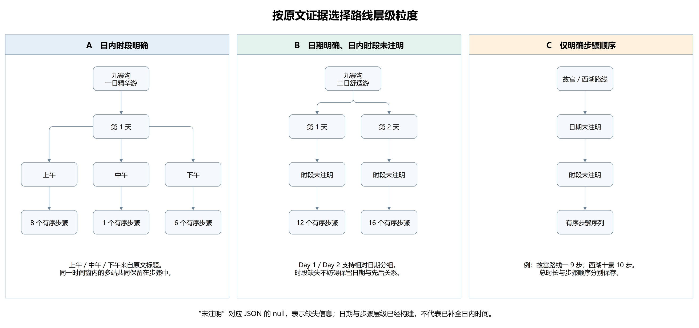

# 实验项目 3 游览路线的层级结构挖掘

## 3.1 数据范围与路线模式

本实验使用项目 1 的正式数据和项目 2 的 V2 实体结果。以 `doc_id` 关联原文 `clean_text`，保留原文字符顺序。三篇官方指南分别对应北京故宫、杭州西湖和九寨沟；从十五篇游客文本中每个景区选择两篇，共六篇作为对比样本，其中两篇为推荐攻略、四篇有作者自述行程依据。

三篇官方指南的组织方式不同。故宫在开头列出四条带编号的路线，后文再介绍区域和历史。西湖以主题标题组织十条线路，使用“途径”列出景点，部分提供路线总时长。九寨沟包含一日、二日和三日三种方案：一日方案按上午、中午、下午分组，逐段列出时刻、交通和游览时长；多日方案使用 Day 标记和景点箭头链，第一天的外围行程还包含叙述性文本。

因此，本实验先识别路线和章节边界，再解析步骤与时间，不直接把全文中的 POI 排成路线。

## 3.2 解析方法与统一表示

采用 Python 标准库的正则表达式、字符串处理、字典和列表实现，不新增模型调用。解析规则针对当前三篇指南及选定游客片段，处理三种主要格式。

故宫提取总览的“路线一～四”，按顶层连字符分割。正文重复的路线不再次输出，历史事件、拍摄推荐及开放时间不加入访问链。路线二、三的“中轴线+”保存为组合成分。原文没有明确给出该组合的完整连接方式，因此保留未展开状态，不将路线一整体复制进去。

西湖将每个“途径”链绑定到所在主题标题，兼容不同长度的破折号。分割时跟踪括号层级，避免把括号中的解释拆成独立步骤。同一链节点内部的并列地点保留在同一步，例如“药王庙、阮公祠”，内部顺序记为未知。“远眺”与普通访问区分，总时长存于路线字段。

九寨沟先识别方案，再识别 Day 或时段。带时刻区间的原文行作为一个移动/活动段；无时刻箭头链按节点组织。三日方案第一天提取县城至神仙池、游后前往漳扎镇的行程，并标明外围范围。介绍性景点清单没有明确游览顺序，不据此建立先后关系；游后可选娱乐没有拼入核心路线。

路线保留 `route_id`、`doc_id`、景区、路线名及步骤列表。步骤统一包含序号、日期、原文时间、归一化时段、景点、活动和证据。一个有共享时间窗的步骤可以包含多个有序景点；并列地点则明确标注内部顺序未知。原文没有明确活动时，用“参观”作概括并标记为推导值。

每个步骤和景点都保存原文切片及 `[start,end)` 位置，使用 Python Unicode 字符索引。游客路线在选定的路线片段内结合 V2 实体和本景区官方名称词表定位，重叠时优先保留完整名称。官方显式节点直接从路线结构读取，避免完全依赖实体识别的召回率。

新增故宫亲子文本和西湖家庭文本提取明确的主路线链。九寨沟实测文本含多条主链、提醒与重复推荐片段，配置只选择五条主行程链，避免把局部强调重复拼成新的访问顺序。配置和自述依据保存在 `samples.json`，选择未以相似度最高为目标。

## 3.3 时间层级与名称处理

层级采用“路线→日期→时段→有序步骤”。九寨沟一日游直接使用原文的上午、中午、下午，多日方案按 Day 组织。有时刻而没有时段标题的游客步骤，按本实验约定的 11:30、13:30、18:00 边界归一化。缺少日期或时段时保留空值；故宫和西湖的未知时间不从总时长或步骤位置推测。

移动时间、游览时间和时刻区间分别记录。例如“原始森林→芳草海（8:10-9:00 步行30分钟，游览时间20分钟）”保存一个 50 分钟的原文区间、30 分钟步行表达和20分钟游览表达。15:40–17:00 的多站段保留共享时间窗，不拆出没有依据的逐站停留时长。

对不同信息粒度，采用以下可核验的层级组织。

| 原文支持的信息 | 输出层级 | 例子 |
|---|---|---|
| 相对日期与日内时段 | 路线→第 N 天→上午/中午/下午→步骤 | 九寨沟一日游按三个时段组织 8、1、6 个步骤 |
| 相对日期，日内时段未注明 | 路线→第 N 天→未注明时段→步骤 | 九寨沟二日游按 Day 1、Day 2 组织 12、16 个步骤 |
| 只明确访问顺序 | 路线→日期未注明→时段未注明→步骤 | 故宫路线一的 9 步、西湖十景线的 10 步 |

图中分组节点与步骤数由实际层级输出生成。`day` 是方案内相对日程序号，不是日历日期。“未注明”对应空值，只保持结构及先后关系，不表示已推断出时间。整批 250 个步骤中，31 步有时段，219 步（87.6%）未注明时段；125 步有相对日程序号。其中日期与时段均有 31 步、仅有日期 94 步、仅有步骤顺序 125 步。新增样本主要提供访问顺序，因此不会降低时间缺失比例。这是原文信息覆盖的限制。

名称归一化仅设置九寨沟语境下的“天鹅湖→天鹅海”和“诺日朗中心→诺日朗中心站”。前者依据同一指南的概述与相邻路线节点推断，后者依据换乘语境；均保留原词。单独出现的“诺日朗”尚未消歧，单列保留并排除出景点对比。西湖题名景观与具体建筑，例如“雷峰夕照”和“雷峰塔”，不直接合并。父区域和子景点、括号附属地点也不强行对齐。

计算路线序列时只折叠相邻同名提及，非相邻的返回访问仍保留。不同方案和不同日期的相同景点不全局去重。外围节点、交通站和泛称出入口保留在路线中，但不进入本实验的景区景点覆盖指标。

## 3.4 结构化结果与质量检查

最终提取 17 条官方路线、185 个官方步骤，另保存六条游客路线、65 个游客步骤，共 250 步。游客样本每景区两篇，分别为故宫 13 步、西湖 13 步、九寨沟 39 步。

| 景区 | 官方路线数 | 官方步骤数 | 带时刻的步骤数 |
|---|---:|---:|---:|
| 北京故宫 | 4 | 24 | 0 |
| 杭州西湖 | 10 | 88 | 0 |
| 九寨沟 | 3 | 73 | 15 |

步骤单位随原文结构而定，数量不能直接跨景区比较。九寨沟一日游有 15 个移动/活动段，二日方案有 28 个节点步骤，三日方案有 30 个步骤；三日方案包含首日两个叙述性行程段。西湖的并列地点可能共用一步。

名称处理同时包含有依据的归一化、保留不同粒度、排除背景、维护原文顺序。故宫、西湖未配置别名映射，原因是所选对比片段中尚无需要且能可靠确认为同一具体节点的别名字面；不能根据空间邻近、集合包含或名称相似直接合并。处理规则与实际例证如下。

| 情况及例子 | 当前处理 | 依据与局限 |
|---|---|---|
| 九寨沟“天鹅湖 / 天鹅海” | 归一为“天鹅海”，保留原词 | 同一官方指南概述和路线的相邻节点支持该语境推断；不是开放域通用映射 |
| 九寨沟“诺日朗中心 / 诺日朗中心站” | 归一为中心站，类型记为换乘站 | 游记换车语境与官方站点对应；不延伸到单写“诺日朗” |
| 故宫“外东路钟表馆” | 在明确链节点中去掉区域前缀，提取“钟表馆” | 属于路线边界解析，非新增别名；原始完整节点仍在证据内 |
| 西湖“雷峰夕照 / 雷峰塔”“南屏晚钟 / 净慈寺” | 分别保留 | 题名景观与具体建筑的访问范围、活动方式不同，不能直接视作相同节点 |
| 故宫“三大殿”与三个具体殿；九寨沟“树正区域”与子景点 | 保留集合节点，排除出具体景点指标 | 有包含关系不等于逐个到访，更不能推断子景点访问顺序 |
| 故宫“午门 / 午门雁翅楼” | 独立保留完整名称，匹配时长名称优先 | 名称子串不证明同一对象；不能把参观展楼当作只经过城门 |
| 西湖“花港观鱼（对面就是太子湾公园）” | 只提取括号前的访问节点 | 括号是方位说明，不能据此判定去了对面的公园；完整文本保留作证据 |
| 单写“诺日朗” | 未消歧提及保留，排除出景点指标 | 缺少具体站点或瀑布对象，不默认合并到中心站或瀑布 |
| 历史背景、城市、路线分组与并列地点 | 只读明确路线片段，过滤背景与分组；并列地点保留内部顺序未知 | 例如“左线”不是具体景点，“药王庙、阮公祠”不能强建内部先后边 |
| 九寨沟县城、神仙池、漳扎镇 | 保留外围行程，标记 surrounding | 文档属于九寨沟不代表所有地点都在九寨沟景区内 |
| 同段重复“原始森林”；不同日期或方案的重复节点 | 指标仅折叠相邻重复，不做全局去重 | 同段重复提及不产生额外访问；非相邻的返回访问和备选方案分别保留 |

程序检查了 693 个带位置的原文锚点，切片不一致为 0；同时检查路线 ID 唯一、步骤编号连续、层级引用完整且顺序一致、POI 位于对应步骤原文范围内，以及作者自述引文与对应正文或标题一致。26 项相关测试通过，覆盖真实路线格式和 Unicode、括号、集合、并列地点、共享时间、未知时间、主链选择及顺序指标等边界。

定向复核发现九寨沟官方末两段分别标为 17:00–17:20 和 17:00–17:35，存在时间重叠。程序保留原文并输出诊断。另有两处故宫组合路线未展开、一处神仙池无序清单、四处游客“诺日朗”歧义提及、两处未展开集合，均可在 `issues` 中追溯。

上述检查证明位置和部分结构约束一致，不代表全部语义正确。目前没有独立的完整人工标注集，人工确认尚未记录，不能据此报告整体准确率、召回率或 F1。

## 3.5 官方与游客路线对比

选择故宫路线一、西湖十景文化之旅、九寨沟一日精华游作基准，每个景区对应两个游客样本，覆盖十五篇游记中的六篇。推荐攻略和作者自述分开标识，具体证据如下。

| 景区与游客样本 | 性质 | 选择与自述依据 |
|---|---|---|
| 故宫半天精华线 | 推荐攻略 | 编号步骤清晰，主题与官方中轴线接近；没有断言为作者实际轨迹 |
| 故宫亲子历史主题线 | 作者自述 | 正文写“这一次带着孩子走进紫禁城”，紧接着列出路线；缺少日期与逐站时刻 |
| 西湖观光车与坐船精华线 | 推荐攻略 | 与官方精华景观线可比较，明确给出完整路线 |
| 西湖亲测家庭省力线 | 作者自述 | 标题写“亲测带上老小都很轻松”，正文列出家庭路线；亲测主张来自标题，未提供轨迹 |
| 九寨沟全线一日速通 | 作者自述 | 正文说明已经到访，并记录 10:00 入园至 17:45 出园的逐段时刻 |
| 九寨沟一日三沟实测线 | 作者自述 | 正文标注“我们的实际路线”，自述实测进出园信息，五条主链分别表示三沟行程 |

`visitor_actual` 仅表示有作者自述依据。来源引文、字段和正文偏移写入 `experience_evidence`；没有进行独立行程核实。新增亲子与家庭样本也使游览主题更多样，不能把它们视为与官方路线完全同目标的实验条件。

采用三个指标：官方景点覆盖率为两条路线景点集合交集大小除以官方集合大小；Jaccard 为交集大小除以并集大小；顺序相似度为两条序列最长公共子序列长度的两倍，除以两条序列长度之和。对比排除交通站、泛称出入口、外围地点、未展开集合及未消歧节点；完整序列和差异名单一并保存。

| 景区 | 游客样本 | 性质 | 官方景点覆盖率 | Jaccard | 顺序相似度 |
|---|---|---|---:|---:|---:|
| 北京故宫 | 半天精华线 | 推荐攻略 | 100.0% | 0.750 | 0.857 |
| 北京故宫 | 亲子历史主题线 | 作者自述 | 44.4% | 0.364 | 0.533 |
| 杭州西湖 | 观光车与坐船精华线 | 推荐攻略 | 50.0% | 0.417 | 0.471 |
| 杭州西湖 | 亲测家庭省力线 | 作者自述 | 50.0% | 0.455 | 0.250 |
| 九寨沟 | 全线一日速通 | 作者自述 | 83.3% | 0.652 | 0.579 |
| 九寨沟 | 一日三沟实测线 | 作者自述 | 61.1% | 0.478 | 0.529 |

故宫游客攻略保留官方中轴线的九个节点，并增加乾清门、珍宝馆、钟表馆，因而覆盖率为 100%，但集合及顺序相似度未达到 1。

故宫亲子自述以历史叙事组织路线，明确写出“三大殿”集合而没有在路线链里逐个列出三个殿。当前规则不把集合展开，因此只有四个与官方相同的具名节点可确认，覆盖率为 44.4%。它不等价于实际漏游了其余节点，而反映名称粒度和证据的限制。

西湖游客样本结合观光车和坐船，与官方文化线共享五个同名景点，且三潭印月与花港观鱼的先后顺序不同。官方三潭印月为远眺，游客路线是乘船游览；当前指标按同名景点计覆盖，观看方式另存。题名景观和建筑没有直接对齐，也使数值低于粗粒度的地理区域比较；不能据此判断游客漏游一半景区。

新增家庭省力线从断桥残雪开始，经过平湖秋月、曲院风荷、花港观鱼，再到三潭印月。与官方线仍共享五个同名节点，但整体方向不同，顺序相似度降至 0.250。括号里仅作方位说明的太子湾公园没有计为实际访问点。

九寨沟游客先走树正沟部分节点，再游右线、左线和树正沟末段，与官方先右线、后左线及下行收尾的顺序存在差异。游客文本提到随机分线和减少非观景停留，可作为这篇样本差异的解释线索，但不足以归因或推广到所有游客。官方首末时刻为 07:00–17:35，游客为 10:00–17:45，对应片段经过时间为 635 和 465 分钟。两者出发时刻、覆盖节点及原文时间一致性不同，该差值不代表节省的游览时间或效率提升。

第二篇九寨沟自述采用左线起步、右线深玩、树正沟收尾的顺序，含珍珠滩与珍珠滩瀑布等另一篇官方一日线未明确列出的访问点。它的具体景点覆盖率为 61.1%，顺序相似度为 0.529。“树正区域”没有展开，提醒和重复推荐片段也未追加为第二次访问。两篇自述已经显示不同组织方式，但样本仍不足以归纳所有游客的路线偏好。

故宫官方没有该路线的明确时长，游客只给 2.5～3 小时范围；西湖官方给约3小时，游客没有总时长；九寨沟游客没有逐站停留时长。因此时间比较保留可观察信息，没有补齐缺失时长，也没有由两个到站时刻相减得到停留时间。

## 3.6 运行与局限

在仓库根目录执行 `python -X utf8 task3/run.py`，即可离线重建全部结构化输出与质量记录。验证命令为 `python -X utf8 -m unittest discover -s task3/tests -v`。程序仅使用标准库，不调用模型，不重新抓取网页。输入摘要、字段、规则及输出位置见 `README.md` 和 `results/summary.json`。

当前规则依赖三篇指南和六篇游客文本的明确格式，对跨句叙述、图片路线和新站点版式的泛化尚未评估。名称映射范围有限；括号关系、集合和组合路线仍存在未展开内容。六篇游客文本中有两篇推荐攻略，四篇也只是作者自述，不能作为独立验证的轨迹数据；其余九篇未进入当前样本范围。时间信息不足的比例较高，等价层级保留了日期或步骤关系，但没有弥补日内时间缺失。后续可补充人工结构标注和带可核验时间的实际行程样本，分别评估路线边界、步骤顺序、时间归属与名称对齐的错误。
