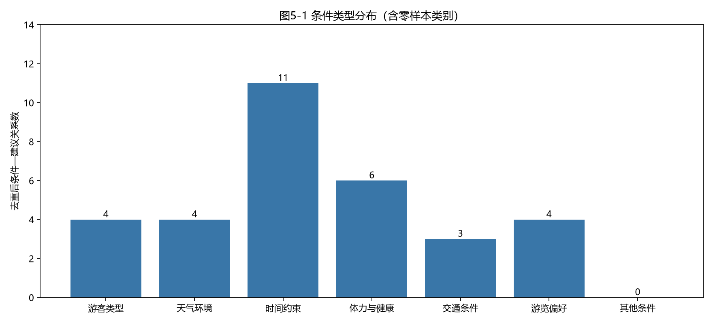
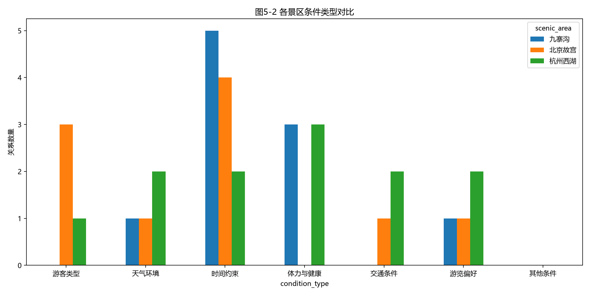

# 实验项目5：条件性游览建议的抽取

## 5.1 输入与抽取规则设计
输入为 task1/data/final/documents.jsonl 的 clean_text，共18篇、3个景区，各1篇官方及5篇游客文本。source_type 沿用上游分类，不重新验证网站身份。输入SHA256见 results/input_manifest.json。
按换行硬分段、相邻两句重叠窗口，共815个窗口。字符偏移采用 Python Unicode 下标，左闭右开。优先级：显式条件 > 隐式情境 > 普通建议。候选151个；建议/可以仅用于召回，不能单独证明有条件。规则全文见 run.py 的 EXPLICIT/IMPLICIT/ADVICE。
模型 deepseek-flash，温度0，thinking disabled，JSON模式，max_tokens 6000；每批6片段、并发4、最多重试3次。完整核心Prompt见 prompt.txt（v2），初版见 prompt_v1.txt。采用条件、建议、证据逐字子串约束，保留组合条件、一对多及段内跨句关系。温度0仍不保证远端模型完全确定，缓存才提供本次结果的精确重放。

## 5.2 批量抽取与复杂表达处理
本轮产生52条原始模型关系，程序校验后37条。批次日志见 results/run_log.json；失败0批。缓存命中数反映最近重放，首次联网信息可在缓存 usage 与 attempts 查看。
一个条件有不同建议时保留多行，例如“体力一般”对应坐观光车与分2天慢慢玩。多分句建议可能保留一个连续动作组，未无依据拆成不完整宾语。跨句仅在同段相邻两句支持，超过该范围可能漏抽。
真实样例：
- `R00001`（gugong_official_df6c311301c59157）：旅游旺季参观时 → 可以在网上提前订票。
- `R00002`（gugong_official_df6c311301c59157）：带小朋友或者是带婴儿车的游客 → 比较推荐购买一日游的产品。
- `R00004`（gugong_official_df6c311301c59157）：故宫博物院实行单向参观所有游客只能从南侧午门进入,经北侧神武门出来 → 游玩的时候一定安排好路线，尽量不要走冤枉路。
- `R00005`（jiuzhaigou_official_88ef5cc31789dc71）：一天时间相对紧凑 → 建议早上早点出发进入景区，全程须采用观光车+步行的方式进行游览。
- `R00006`（jiuzhaigou_official_88ef5cc31789dc71）：初入高原的朋友 → 第一日尽量不进行剧烈的运动。
- `R00007`（jiuzhaigou_official_88ef5cc31789dc71）：如果您时间充足 → 三天的时间您可以把九寨沟县城、九寨沟神仙池景区一并游览完。

## 5.3 映射表、分类与去重
一行对应一个独立关系；pair_id 为本次校验结果序号（跨版本不稳定），doc_id 与字符位置用于稳定溯源。字段包含condition_type、condition、recommendation、scenic_area、source_type、source_text、evidence_span、offsets、url、prompt_version、review_status与sources。sources保留所有合并前原始关系、文档、原文和位置。
分类为游客类型、天气环境、时间约束、体力与健康、交通条件、游览偏好、其他条件。由模型按适用情境标记，仍需独立核验。
按同景区、条件和建议同时规范化相等合并，规范化仅删除标点与无语义引导前缀，不删否定、数字。37 → 32条，合并5条，实际案例见 results/dedup_log.json。条件相同且建议有包含/高字符相似度者仅列为 near_duplicate_review.json 待判定，不自动吞并语义不同或范围不同的建议。不是全面语义去重。

## 5.4 人工校验与误差分析
初版结果保存在 baseline，初版候选144、原始关系71、去重62。实查发现修辞效果误作行动、对象残缺、时间边界反向和纯先后关系。v2加入反例约束，候选增加人多/拥挤/排队召回。第二轮仍有模型不遵守要求的结果，因此增加小范围可解释隔离规则，保留 rejected_pairs.json，不修改模型原始输出。优化数量变化不代表精度提升的量化证据。
自动隔离15条，典型案例：
- 漫步群山之余 → 千万注意脚下安全：`sequence_not_condition`（自动隔离，非人工判定）。
- 吃饭 → 选这里：`unresolved_recommendation_target`（自动隔离，非人工判定）。
- 提前看好未来一周的天气预报，哪天晴天选哪天 → 虽然晒，但蓝天配黄瓦红墙拍照才好看：`evaluation_not_action`（自动隔离，非人工判定）。
- 带娃/赶时间 → 半天精华线（2.5～3小时⏳）：`invalid_recommendation`（自动隔离，非人工判定）。
- 进门 → 先冲珍宝馆，人最少、体验最好✅：`sequence_not_condition`（自动隔离，非人工判定）。
- 带老人小孩 → 慎选：`unresolved_recommendation_target`（自动隔离，非人工判定）。
- 赶时间 → 慎选：`unresolved_recommendation_target`（自动隔离，非人工判定）。
- 体力好的年轻人 → 适合：`unresolved_recommendation_target`（自动隔离，非人工判定）。
- 容易晕 → 选手摇船：`negation_boundary`（自动隔离，非人工判定）。
- 下午3点后 → 记得上午去：`time_boundary_needs_context`（自动隔离，非人工判定）。
- 7 座古寺一次串 → 切记提前预Y：`list_not_condition`（自动隔离，非人工判定）。
- 财👼庙（⚠️修缮中，11 月后再来）、灵隐寺、法喜寺 → 切记提前预Y：`list_not_condition`（自动隔离，非人工判定）。
对规则未命中窗口每文档均匀取至多2个，本轮共36个，经同模型辅助检查发现0条通过校验关系。初轮规则外曾发现“中轴线人最多→拍照可去两侧宫殿”，据此扩展规则。抽查量很小且同模型存在共同盲点，零发现不等于无漏抽。
results/human_review.csv、Excel人工审核页包含分层预测样本及无预测片段，供填写 FP/FN/Boundary/Association/Classification、修正条件与建议、审核人。全部待人工确认，没有真实人工标注，不报告人工Precision/Recall/F1。自动检查只能证明证据字符串可对齐，无法证明语义或分类正确。个别泛化条件、路线编号指向不明、来源措辞错误仍可能保留，须结合原文确认。

## 5.5 分类统计与可视化
统计单位是同景区条件与建议规范化去重后的关系，共32条。类别数量为：{"游客类型": 4, "天气环境": 4, "时间约束": 11, "体力与健康": 6, "交通条件": 3, "游览偏好": 4, "其他条件": 0}。时间约束关系最多，说明本语料更常讨论时段与游程安排，不能推广为旅游总体规律。其他条件零样本仍显示，不补造关系。

基础数据见 category_counts.csv、scenic_category_counts.csv。来源对比以关系×来源类型计数，多来源关系可重复参与，故不可将其总和当作去重关系数。不同景区文档长度和写作风格不同，绝对计数不等于发生率。
